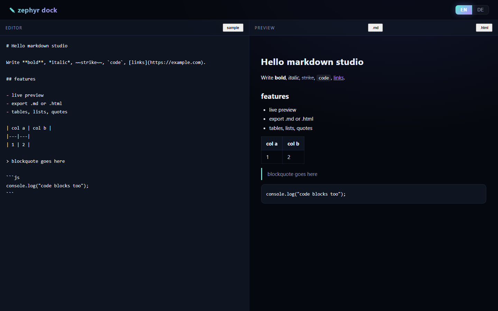
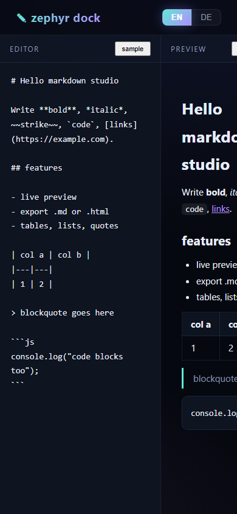

# Zephyr Dock — Markdown Studio

A split-pane markdown studio: live rendered preview, syntax-rich output (tables, code, quotes), and one-click export to .md or standalone .html.

<div align="center">


**[Live Demo](https://ruslanfridenli.github.io/zephyr-dock/)** · **[Deutsch ↓](#-deutsch)**

</div>

---

## Screenshots






## Features

- Live split-pane markdown preview
- Tables, code blocks, quotes, strikethrough
- Export as .md or standalone .html
- Sample document included
- Dark glass UI
- English/German interface

## Local development

```bash
git clone https://github.com/ruslanfridenli/zephyr-dock.git
cd zephyr-dock
# open index.html in a browser, or serve statically:
npx serve .
```

No build step, no dependencies — pure static site.

---

## 🇩🇪 Deutsch

### Zephyr Dock — Markdown Studio

Ein Markdown-Studio im Split-View: Live-Vorschau, umfangreiches Rendering (Tabellen, Code, Zitate) und Export als .md oder eigenständige .html per Klick.

### Funktionen

- Live-Split-View-Markdown-Vorschau
- Tabellen, Codeblöcke, Zitate, Durchgestrichenes
- Export als .md oder eigenständige .html
- Beispieldokument inklusive
- Dunkles Glass-UI
- Englische/deutsche Oberfläche

### Lokale Entwicklung

```bash
git clone https://github.com/ruslanfridenli/zephyr-dock.git
cd zephyr-dock
npx serve .
```

Reine statische Seite — kein Build-Schritt, keine Abhängigkeiten.

---

## ☕ Support / Unterstützen

Wenn dir diese Website beim Lernen hilft, würde mir eine Spende sehr viel bedeuten und dabei helfen, sie weiterzuentwickeln. Alternativ kannst du das Projekt mit einem Stern im github repo unterstützen. Vielen Dank!

- Solana: `zQpgZ6nGigww7vYpz3Qqxb1BT44kqS567vFaLTeHagS`
- Ethereum: `0x9c4fE1B2e9a1A9c22312c8296BB088Ca0e8F1B4e`
- Bitcoin: `bc1p2jltk9ya9kyzv35d8kxn7mmg9jqkx66cqtgzqwe75zlr4v9jk4hsv468q7`

---

Made with care. Feedback welcome via issues.
